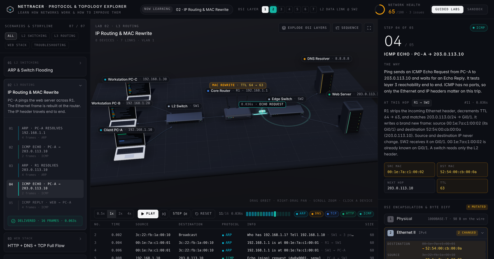

# NetTracer · Protocol & Topology Explorer

Live at **[nettracer.andrewlengly.com](https://nettracer.andrewlengly.com)**

NetTracer is an interactive network lab in the browser. Packets cross a 3D isometric network one frame at a time, a Wireshark-style capture table follows along, and a layer-by-layer inspector shows exactly which header fields change at each hop. Each lab ends with one-click fixes (VLANs, gateway repair, HSRP, TLS, route restore) that re-run the simulation so the improvement is visible.

## Labs

| # | Lab | What it shows |
|---|-----|---------------|
| 01 | ARP & Switch Flooding | Broadcast flooding, MAC learning, unicast forwarding |
| 02 | IP Routing & MAC Rewrite | The L2 frame rebuilt at R1 while the IP header stays the same, TTL 64 → 63 |
| 03 | HTTP + DNS + TCP Full Flow | DNS lookup, three-way handshake, GET and 200 OK |
| 04 | Broken Gateway Diagnosis | ARP timeouts against a gateway nobody owns |
| 05 | Router Failure & HSRP | A dead router, then a standby taking over the virtual IP |
| 06 | Missing Route to 8.8.8.0/24 | A drop at R1 with no matching route |
| 07 | Inter-VLAN Routing on a Stick | 802.1Q retagging from VLAN 10 to VLAN 20 on one trunk |

Sandbox mode adds laptops and servers, lets you drag devices around, and runs ping, DNS or web traffic between any two hosts.

## How it works

`src/NetTracer.jsx` is one self-contained component in three parts.

1. **Network engine.** Pure functions turn the topology and a traffic flow into an event list. ARP caches, switch MAC tables, VLAN domains, HSRP election, longest-prefix routing, TTL and checksums are all computed from live device config. Edit any IP, gateway, VLAN, route or power state and the capture changes with it.
2. **Three.js stage.** A 28° telephoto camera over a matte diorama with procedural laptops, switches, a router and rack servers. Packets travel along floor splines as capsules, and "Explode OSI Layers" splits each packet into its L2, L3, L4 and L7 slabs.
3. **React interface.** Header OSI strip and health score, lab storyline, playback bar, capture table, step narrative, byte diff and the improvements panel. Styled with Tailwind, icons from lucide-react.

## Run locally

1. `npm install`
2. `npm run dev`
3. Open the local address Vite prints.

## Deploy

Vercel picks up the Vite build automatically (`npm run build`, output `dist`).

Built by [Andrew Leng Ly](https://www.andrewlengly.com).
